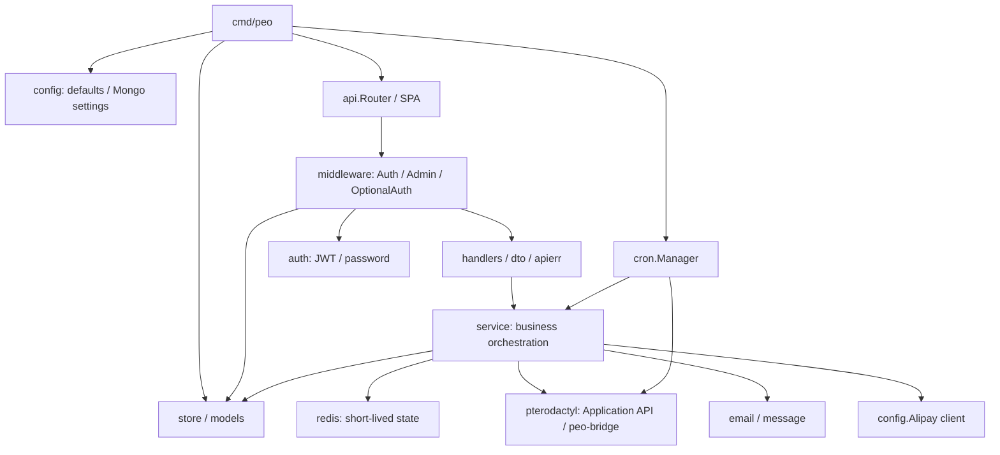
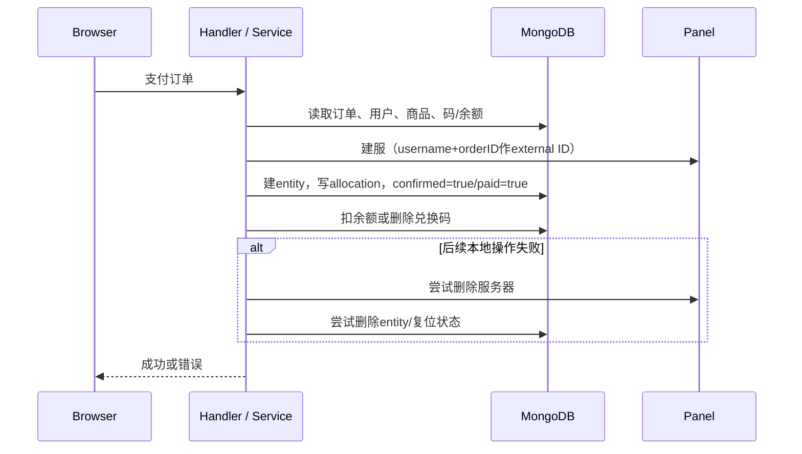

# server 后端静态审查报告

审查日期：2026-10-24（Asia/Shanghai）。任务依据：`PLAN-MigrationReview.md`。

后续整改：2026-10-25 的实现、迁移影响和运行验证见 [`IMPLEMENTATION-MigrationReview.md`](./IMPLEMENTATION-MigrationReview.md)。下文保留原始静态审查结论与当时证据边界。

## 1. 范围、基线与证据限制

本报告审查当前工作区中的全部手写后端 Go 源码和已有测试，包含未提交修改与未跟踪文件。没有运行构建、测试、静态分析工具或外部服务；所有测试结论仅指测试源码覆盖的行为，不代表当前通过。没有修复源码、配置、测试或修改现有文档。本报告是本次唯一新增交付物。

排除 `legacy/`、调试二进制、`server/web/assets` 生成资源和第三方依赖实现；关联阅读项目约定、API/路由/数据/架构文档、CI 和部署配置。Flutter/Panel 只在协议边界上定向核对。既往验收记录不能替代当前工作区的运行验证。

证据状态：**静态可确认**指实现或契约差异可由源码确认，实际触发和影响仍未运行复现；**待运行验证**指结果还依赖运行环境、调度或上游行为；**设计建议**指取舍建议，不视为已证实故障。严重度与证据置信度分别记录。逐文件“已审”仅表示完成静态阅读，不表示无缺陷。

主代理负责拆分、关联契约阅读、重点证据复核和汇总；三个 `development_assistant` 分别审查 API/身份、业务/存储、基础设施/外部服务，均只读，不执行检查。

### 1.1 审查开始时的 Git 状态

HEAD: `0a9a17a33ac57cf5158ecd868729b49750e57a3a`。枚举 77 个 Go 文件，其中 12 个测试文件、65 个非测试文件。

```text
 M .dockerignore
 M .github/workflows/ci.yml
 M .gitignore
A  ".run/Flutter Web - WASM Debug.run.xml"
A  ".run/Peo Backend - Compose Build.run.xml"
 M AGENTS.md
 M README.md
 M docker-compose.yml
 M docs/API.md
 M docs/ARCHITECTURE.md
 M docs/CONTRACT-DATA.md
 M docs/CONTRACT-ROUTES.md
 M docs/PLAN.md
 M flutter/lib/main.dart
 D flutter/lib/models/probe.dart
 D flutter/lib/models/probe.freezed.dart
 D flutter/lib/models/probe.g.dart
 M flutter/pubspec.lock
 M flutter/pubspec.yaml
 M flutter/test/widget_test.dart
 M flutter/web/index.html
 M server/Dockerfile
 M server/cmd/peo/main.go
 M server/internal/api/dto/admin.go
 M server/internal/api/dto/auth.go
 M server/internal/api/handlers/admin_handler.go
 M server/internal/api/handlers/auth_handler.go
 M server/internal/api/handlers/product_handler.go
 M server/internal/api/response.go
 M server/internal/api/router.go
 M server/internal/api/router_test.go
 M server/internal/apierr/apierr.go
 M server/internal/auth/auth.go
 M server/internal/config/config.go
 M server/internal/config/default_settings.toml
 M server/internal/middleware/middleware.go
 M server/internal/models/models.go
 M server/internal/service/admin_service.go
 M server/internal/service/auth_service.go
 M server/internal/service/cryptoo/cryptoo.go
 M server/internal/service/order_service.go
 M server/internal/service/product_service.go
 M server/internal/service/pterodactyl/api_manager.go
 M server/internal/service/pterodactyl/data_models.go
 M server/internal/service/pterodactyl/instance.go
 M server/internal/service/pterodactyl/self_check.go
 M server/internal/service/recharge_service.go
 M server/internal/service/server_service.go
 M server/internal/service/work_order_service.go
 M server/internal/store/content.go
 M server/internal/store/indexes.go
 M server/internal/store/keys.go
 M server/internal/store/orders.go
 M server/internal/store/query.go
 M server/internal/store/store.go
 M server/internal/store/users.go
 M server/internal/store/wares.go
?? .github/workflows/panel-extension.yml
?? .vscode/
?? PLAN.md
?? docs/CONSOLE-ACCEPTANCE.md
?? docs/FRONTEND-DESIGN.md
?? docs/PLAN-MigrationReview.md
?? flutter/devtools_options.yaml
?? flutter/lib/api/
?? flutter/lib/models/admin.dart
?? flutter/lib/models/admin.freezed.dart
?? flutter/lib/models/admin.g.dart
?? flutter/lib/models/auth.dart
?? flutter/lib/models/auth.freezed.dart
?? flutter/lib/models/auth.g.dart
?? flutter/lib/models/content.dart
?? flutter/lib/models/content.freezed.dart
?? flutter/lib/models/content.g.dart
?? flutter/lib/models/documents.dart
?? flutter/lib/models/documents.freezed.dart
?? flutter/lib/models/documents.g.dart
?? flutter/lib/models/order.dart
?? flutter/lib/models/order.freezed.dart
?? flutter/lib/models/order.g.dart
?? flutter/lib/models/recharge.dart
?? flutter/lib/models/recharge.freezed.dart
?? flutter/lib/models/recharge.g.dart
?? flutter/lib/models/server_console.dart
?? flutter/lib/models/server_console.freezed.dart
?? flutter/lib/models/server_console.g.dart
?? flutter/lib/models/site.dart
?? flutter/lib/models/site.freezed.dart
?? flutter/lib/models/site.g.dart
?? flutter/lib/pages/
?? flutter/lib/router/
?? flutter/lib/state/
?? flutter/lib/theme/
?? flutter/lib/widgets/
?? flutter/test/api_client_test.dart
?? flutter/test/app_test.dart
?? flutter/test/console_output_test.dart
?? flutter/test/design_system_test.dart
?? flutter/test/server_console_contract_test.dart
?? flutter/test/server_list_management_test.dart
?? flutter/test/server_text_editor_test.dart
?? flutter/test/server_workspace_navigation_test.dart
?? flutter/test/token_store_test.dart
?? flutter/web/peo_echarts_logo.js
?? pterodactyl/
?? server/cmd/peo/__debug_bin.exe
?? server/cmd/peo/__debug_bin.exe3109537976
?? server/internal/api/dto/console.go
?? server/internal/api/handlers/console_handler.go
?? server/internal/api/handlers/console_stream_test.go
?? server/internal/api/handlers/console_terminal_test.go
?? server/internal/middleware/middleware_test.go
?? server/internal/service/admin_service_test.go
?? server/internal/service/console_service.go
?? server/internal/service/console_service_test.go
?? server/internal/service/pterodactyl/api_manager_test.go
?? server/internal/service/pterodactyl/bridge.go
?? server/internal/service/pterodactyl/bridge_test.go
?? server/internal/service/pterodactyl/panel2_test.go
?? server/internal/service/pterodactyl/self_check_test.go
```


## 2. 架构、模块与实现

### 2.1 依赖与请求链路



这是静态包职责图；HTTP 客户端、邮箱和站内消息内部也使用配置或存储。业务服务依赖普通 context、模型和 apierr，不依赖 Gin。中间件允许查询用户；API handler 不直接访问 Mongo。服务中的 `net/http` 用于上游客户端，并非违规。全局默认服务、Store/Mongo、Redis、配置及票据状态使测试替换与多实例一致性需要额外设计。

### 2.2 模块职责、数据、共享状态和错误

| 模块 | 入口/关键类型 | 实现、状态与错误处理 | 测试与维护风险 |
|---|---|---|---|
| 启动 | `main` | config.Init → store.Init/索引 → 读取或导入/seed app_settings → config.LoadSettings → Bootstrap/Start → Router/HTTP。Mongo 连接只读环境变量；业务配置来自 Mongo。HTTP 读10s、写20s、空闲30s、头1MiB。关闭先 HTTP(10s)，再 cron、Mongo、Redis | 没有启动/关闭专属测试；监听错误 os.Exit 不走清理；Bootstrap 实际异步 |
| API | Router、各 Handler、DTO | JSON bind、ObjectID 边界解析、身份取 middleware、service 编排、统一 envelope。Alipay literal response、文件 stream、WebSocket 是明确例外。路径错误 ID 用404，JSON/validator错误用 validation_failed | route table、静态资源、部分认证绑定测试；没有全部 handler 行为测试 |
| 错误 | apierr.Error/AsError、handler.fail | 明确业务 code/status/message；未知错误转安全 internal message；cause 用于日志。部分通知、补偿和持久化失败只写日志，必须按业务后果看待 | 分层和路由测试不能代替业务故障验证 |
| 身份 | GenerateToken/ParseToken、Auth/OptionalAuth/Admin | 24h/60d JWT、随机 jti；强认证查 blacklist、按 sub 重新加载用户、使用当前数据库权限。密码是 MD5(password+共享salt)。注册、改密/改邮箱、重置密码、Panel镜像由 AuthService 编排 | 无 auth 服务/密码/撤销故障专属测试；默认密钥、首次管理员及镜像密码见问题清单 |
| 商品 | ProductService.Refresh/Storefront/Detail/CacheEggs | Mongo 规格→Panel Egg/Tag元数据→商品展示；商品目录由 mutex 保护，模板缓存使用 sync.Map；冷启动也可触发刷新。管理员创建/更新验证模板和配置并刷新目录 | 无商品完整行为测试；配置切换与缓存版本没有统一快照 |
| 订单 | PriceFor/Create/PayWithKey/PayWithBalance/provision | Create 冻结价格；支付查归属/paid；Panel先建服→Mongo entity→allocation→confirmed/paid；余额随后扣减；码支付随后删码。失败尝试删除Panel和实体 | 无订单服务测试；跨系统事务依靠补偿，缺少持久重试闭环 |
| 实例 | entityFor/List/Status/Renew/RenewWithBalance/Reinstall/RequestDelete | 所有权或管理员权限；码续费基于 max(expiry,now)，余额续费加存储日期的一个日历月；重装验证商品 allowlist 与 Tag。删除申请、管理员决定、过期扫描协作 | 固定 grace 单测不是生命周期验证；并发更新与外部操作不能靠 Redis 冷却保证 |
| 充值 | ByKey/PreCreate/Status/HandleAlipayNotification | 充值码加余额再删码；Alipay 预下单生成16位trade number、写pending日志和QR；handler验签后按trade查log，按status避开顺序重复回调，再入账/记成功 | 无充值服务测试；幂等判断与资金变更分离 |
| 控制台 | ConsoleService.target、Ticket/ConnectTerminal、文件/备份/startup | 每次解析 PEO entity 所有权，再通过 bridge 访问 Panel UUID；能力检查含协议、扩展ID、read/write scope。路径规范化、action参数白名单、备份归属、startup允许值。文件和备份流只走可信URL，Panel token不进入浏览器 | 票据/归属/路径/备份与帧过滤有针对性单测；上传限额与断流错误见问题清单 |
| 会话 | terminalState、ticket/active maps、handler.Terminal | 已认证POST签发30s单次票据，绑定user/entity/JWT jti与到期；无Bearer WS入口先检查精确Origin再消费票据；建立上游短期凭据并刷新，过滤认证帧，客户端只允许读取日志/统计；注销取消本进程连接，活动连接轮询撤销 | 进程内 map 有锁；多实例票据需要粘性路由或共享状态。完整成功握手→注销断连跨层测试尚缺 |
| 内容 | Gallery/Message/WorkOrder/Admin | 图库公开列表只含通过项，用户投递、点赞、按归属删；消息按receiver读/已读/删除；工单创建/管理员关闭后站内信/邮件；管理端汇总用户、订单、产品、码、审批与设置 | 无对应服务专属测试；分页、重复关闭/点赞策略和通知投递需要按产品语义验收 |
| Store/models | Doc、Orders/Users/Keys/Entities等仓库 | ObjectID关联、BSON内嵌Doc与旧doc字段归一化；通用查询默认超时、cursor关闭；insert/set更新时间。$inc和多数更新/删除封装会丢弃匹配数；多个列表全量读取，排序多为单字段createdAt | 无store/model测试；旧ID兼容、数值边界、排序稳定性与索引需要集成验证 |
| 配置/Redis | LoadSettings、SaveSettings、redis.client/Reset | 构造 fresh viper+Alipay 后锁内替换；管理员先内存应用再Mongo持久化、失败回滚、成功Reset Redis。Redis懒建，用于冷却/验证码/撤销；Get/Limited混淆故障与不存在 | 两个设置helper单测；没有并发save、依赖故障、在途请求刷新验证 |
| 调度/探测 | Manager、CheckServers、ProbeAll/Ping | 5个任务：目录1m、模板5m、生命周期5m、清码30m、探测30s；job有2m/10m/5m等独立context。探测外层限制16并发，成功累计在线时间并缓存30s | cron包装对内层goroutine无防重叠效果；Ping未取消底层IO |
| 外部客户端 | Client、BridgeClient、email、random、cryptoo | Panel API 15s/缓存/容量4信号量；Bridge普通请求30s/8MiB JSON限制、拒绝redirect、关闭body；流传输由ctx控制。SMTP连接10s/发送20s并关闭连接；消息持久化失败仅日志；安全码用crypto/rand但有fallback分支 | Panel httptest较丰富；邮件、码生成、随机源、消息投递无专属测试 |
| 资源/部署 | embed.Assets、api.bundle/static、buildinfo | 构建嵌入Flutter；缺资源时读磁盘；NoRoute排除API缺失路径并处理SPA/MIME；版本由链接参数注入 | static_test覆盖来源、fallback、MIME；CI/镜像见第5节 |

### 2.3 关键业务时序和设计取舍



Panel 先行避免在上游失败时提前扣款，但引入免费开服窗口和跨系统补偿需求。固定 external ID 和 Mongo 实体唯一索引能够约束部分重复写入，却不是支付状态的原子领取。**不能仅凭 paid 的先读后写断言同一订单在真实 Panel 上必定产生两台服务器**，上游唯一性会影响结果；可确认的是本地没有支付状态机/持久恢复记录。

Alipay：验签 → 按 OutTradeNo 取log → success则直接回应 → $inc余额 → 更新Status/Code → 回应success。唯一trade索引约束的是日志创建，不能防止同一日志被并发结算。

续费/删除：续费分别写期限、清删除状态、删确认、同步Panel；扫描先全量读取实例快照，再依过期/grace/status决定 suspend/delete/恢复。两条链路没有共享原子状态条件；资金、有效期、销毁授权不是一个事务边界。

控制台：Bearer认证 → PEO归属校验 → 单次票据 → 精确Origin WS握手 → 票据/JWT/用户复查 → Wings短期凭据代理 → 定时续凭据/撤销检查 → 注销或退出取消。普通用户 `/user/pterodactyl-session` 未注册；现有控制台以PEO为浏览器唯一授权边界。

## 3. 问题清单（按影响排序）

P1：可造成账户/资金/数据重大影响；P2：可用性、错误结果或重要故障处理；P3：保障与维护差异。以下均为当前源码证据，未运行复现。每项给出的验收均为后续整改需要执行的检查，本次未执行。

### R01 · P1 · 空 JWTSecret 回退到源码公开固定密钥

- 证据：`server/internal/config/default_settings.toml:34` 默认空；`server/internal/auth/auth.go:25` 常量、`:50`算法选择、`:95`解析；`server/internal/middleware/middleware.go:44`强认证。
- 触发/链路：部署未设置随机JWTSecret，调用者取得真实用户ID后可用源码已知密钥签名该sub，再由Auth加载真实用户。数据库重查能阻止单靠admin claim提权，却不能防止真实账户冒用，包括已知管理员ID。
- 影响：默认安装的身份信任边界失效。静态可确认，置信高；没有执行令牌伪造或检查实际部署配置。
- 建议/验收：首次初始化生成独立高熵密钥，空值拒绝启动/签发；明确已有令牌失效和轮换兼容策略。验收空/默认密钥不能认证，自定义密钥登录正常，旧令牌依策略失效。

### R02 · P1 · Alipay 入账与结算状态分离，可重复入账

- 证据：`server/internal/service/recharge_service.go:192`查log、`:197`查success、`:206`加余额、`:212`写成功，失败只日志、最终仍回应success；`server/internal/store/users.go:94`无条件$inc、`server/internal/store/content.go:128`独立状态更新。
- 触发/影响：两个成功回调同时读到pending，各自入账；或入账后MarkPaid失败/进程中断，重试再次加钱。若已响应success则也可能无自动重试，留下pending但余额已增加。
- 建议/验收：建立唯一结算账本/条件领取+可恢复状态机，或在支持事务的Mongo部署中把账本、余额、结算绑定。不能只把状态提前标success，否则会变为漏入账。并发重放、各写入边界故障及崩溃恢复后都只能入账一次、状态可对账。静态可确认，置信高。

### R03 · P1 · 兑换码没有原子消费权

- 证据：`recharge_service.go:85`查码→`:95`加钱→`:99`删码；`server_service.go:239`查码→`:255`删除；`order_service.go:175`查码→provision→`:189`删除（以上位于 `server/internal/service/`）。`server/internal/store/keys.go:58`、`:111`丢弃DeletedCount；`store/query.go:195`零删除也返回nil。
- 触发/影响：同一码跨用户、跨实例或跨订单并发读取，多个请求取得同一消费资料；第二个删除零条仍继续成功。充值码可重复入账，商品码可重复授权开服/续费；每用户/实体冷却不能锁住全局码。
- 建议/验收：原子领取码并检查确实取得消费权，绑定业务操作和补偿记录；码期限也在条件中校验。并发跨账号/实例/订单最多一个业务效果；故障恢复不能丢码或重复消费。静态可确认，置信高；具体Panel开服结果依上游约束。

### R04 · P1 · 余额检查与扣减不原子

- 证据：`server/internal/service/order_service.go:216`读余额判断、`:223`扣款；`server_service.go:294`检查、`:297`扣款；`server/internal/store/users.go:94`只按ID $inc。
- 触发/影响：同账户不同订单/续费同时通过旧余额检查后扣减，总支出可超过余额；Mongo负数回读到Go uint的具体错误表现待运行验证。
- 建议/验收：按balance>=cost条件原子扣减并检查匹配数，建立退款/开服恢复账本。余额不足覆盖总支出时只有允许数量成功；最终余额非负且无无主免费实例。静态可确认竞态，置信高。

### R05 · P1 · 续费与销毁缺少共同状态条件，可销毁已续费实例

- 证据：`server/internal/service/admin_service.go:233`直接调用`pterodactyl.ConfirmDelete`；`server/internal/service/pterodactyl/self_check.go:138`重读实体却不检查是否仍有待删确认、当前期限或删除状态，就调用Panel删除。另有`:41`读取全量快照、`:57`按expired/tooLate/status=2删除的扫描分支；`server/internal/service/server_service.go:262`、`:303`更新日期后另行清状态。删除前无带版本/期限/status条件的原子领取。
- 触发/影响：管理员打开待删列表后，用户续费并清除确认，旧页面的批准请求仍可立即删除该实例；或数据中已有status=2时，扫描读完旧快照后用户成功续期，扫描仍可销毁。**当前生产调用点没有发现将DeleteStatus写为2的路径，不能声称普通管理员审批会先置2再交给扫描**；该扫描场景明确以已有该状态记录为前提。是否允许管理员明确强制删除已续期实例需产品确认，但“处理旧待删申请”的入口当前没有区分这种意图。静态可确认无条件删除和竞态窗口，业务预期及真实交错待运行验证，置信高。
- 建议/验收：原子状态机协调renewing/deleting，资金与销毁资格必须共享版本/条件；仅在删除前再次读取仍留有检查后竞态。屏障控制“扫描读取→续费→删除”交错，成功续费实例不能被旧扫描销毁；进入不可逆删除前明确拒绝续费且不扣款。

### R06 · P1 · 首次管理员创建存在竞争，Panel 初始密码可预测

- 证据：`server/internal/service/auth_service.go:130`Count→`:138`total==0授管理员→`:141`insert；`:160`创建Panel用户、`:164`密码为用户名、`:166`RootAdmin=u.IsAdmin；按需建镜像`:359`同样用户名密码。`server/internal/store/users.go:124`以明文存镜像密码。
- 触发/影响：空库不同用户名/来源同时注册可在插入前都读到0而得到管理员；对应Panel还可能授root权限。镜像账户创建成功且用户尚未主动改密时，知道用户名即知道初始密码。未检查实际部署是否允许直接登录Panel或已有密码已轮换。
- 建议/验收：首次管理员用一次性原子bootstrap授权或显式管理员初始化；镜像密码独立随机、最小权限，不以用户名作密码；清理不再需要的明文密码存储须明确存量迁移。并发首批注册仅一个授权管理员；镜像不能用用户名登录。静态可确认，置信高；实际登录未验证。

### R07 · P2 · 撤销检查混淆 Redis 故障与未撤销

- 证据：`server/internal/middleware/middleware.go:44`只在Limited=true拒绝；`server/internal/redis/redis.go:60`Exists出错返回false；`middleware.go:77`OptionalAuth完全不查blacklist。
- 触发/影响：已注销JWT在Redis不可用时仍被强认证接受；正常Redis下OptionalAuth仍可能附着已注销身份，影响公共个性化状态。不是所有验证码和冷却都应采用同一个故障策略。
- 建议/验收：撤销查询返回明确error，保护接口按既定策略拒绝/降级；OptionalAuth也尊重撤销。验证注销token、Redis故障/超时和匿名个性化行为。静态可确认，置信高。

### R08 · P2 · 续费码过期校验缺失，失败补偿未恢复日期

- 证据：`server/internal/service/server_service.go:239`只查SpecID而无key.Exp判断；`:262`更新日期成功后，`:266`清删除状态失败会restoreKey但不回退日期；`order_service.go:179`购买路径则检查期限。
- 触发/影响：清理任务尚未删除的过期码能续期；部分写入失败可得到延长有效期且码被恢复，重试再次延长。同实体并发余额续费还可能基于同一旧日期写同一newDate，扣两次仅延长一次（`:285`读取、`:302`计算、`:303`写入）。
- 建议/验收：消费期限与续费状态原子化、版本条件更新；补偿记录精确覆盖已生效字段。验证过期码、每个写入点失败和并发两次续费，金额/码消费与累计时长一致。静态可确认，置信高。

### R09 · P2 · 开服/删除补偿没有持久恢复闭环

- 证据：`server/internal/service/order_service.go:312`写entity失败后忽略Panel删除结果；`:328`rollback只记错误，删除本地entity不依赖上游删除成功；`:225`使用新配置client补偿。`server/internal/service/pterodactyl/self_check.go:59`先删Panel再删Mongo；`:138`ConfirmDelete同样顺序。
- 触发/影响：Mongo失败并伴随上游补偿失败/请求ctx取消，会遗留无实体的Panel服务；反方向外部删成功但本地删失败留下悬挂记录。后续重试遇到Panel404能否清本地还依赖客户端/上游语义，不宣称必定自动恢复。配置切换还可能把补偿发送到不同Panel。
- 建议/验收：持久记录provision/delete阶段、固定上游目标标识，以独立有界补偿context和重试/对账恢复；明确不存在目标视为已删除。每个外部/本地写入边界注入故障，恢复后无免费孤儿、无永久悬挂记录。静态可确认缺少恢复记录，置信高；存量影响待运行验证。

### R10 · P2 · cron 防重叠、panic恢复及停止边界未覆盖真实任务

- 证据：`server/internal/cron/cron.go:44`安装Recover/SkipIfStillRunning；`:64`注册回调调用withContext；`:117`withContext只加wg后另起goroutine；`:93`Stop等待cron ctx或30s后仍`:101`无条件wg.Wait。
- 触发/影响：回调立即结束后Skip锁已释放，实际job仍运行，下个tick可重复启动；内层panic不在外层Recover调用栈中，可能终止进程；Stop未取消后台context且最终等待不受30s上限约束。多实例各自执行同任务也无分布式互斥。
- 建议/验收：受cron wrapper管理的函数同步执行真实任务，Bootstrap另行管理；统一父取消context、总关闭期限和资源关闭顺序。验证长任务跨tick不重叠、panic按策略恢复、取消传播和超时关闭。静态可确认，置信高。

### R11 · P2 · Minecraft 探测超时不终止底层 IO/goroutine

- 证据：`server/internal/service/status/minecraft.go:48`建独立10s context，`:54`使用net.Dial、连接读无deadline；`:85`超时只让调用者返回。`server/internal/service/server_service.go:164`周期ProbeAll、`:191`调用Ping。
- 触发/影响：黑洞/半开目标导致探测goroutine在Dial/Read上停留；返回通道是无缓冲，调用者超时后，迟到结果发送也可能永久阻塞。外层16并发不能约束已经逃逸的底层goroutine，反复探测可累积。
- 建议/验收：Ping接收上层ctx，DialContext+连接deadline/取消关闭，结果发送也能被取消。模拟连接/响应延迟和迟到返回，重复探测后goroutine与连接数回落。静态可确认，置信高；资源增长未运行测量。

### R12 · P2 · 上传限额只检查 Content-Length

- 证据：`server/internal/api/handlers/console_handler.go:299`传入ContentLength；`server/internal/service/console_service.go:650`仅拒绝声明长度>10GiB；`:663`直接io.Copy multipart。
- 触发/影响：chunked长度=-1通过检查，实际读取量无10GiB限制。此处确认的是PEO自身声明的上限可被绕过；上游配额仍可能限制最终磁盘使用，不能推断全局无限写入。
- 建议/验收：对实际读取字节计数并在limit+1时停止，取消pipe/上游并清理部分产物；验证未知长度超限、边界、取消与上游提前失败。静态可确认，置信高。

### R13 · P2 · 未知图库管理员动作执行删除

- 证据：`server/internal/api/handlers/admin_handler.go:278`ReviewGallery只有action=pass分支，其余`:292`一律DeleteGalleryItem；路由是动态action。
- 触发/影响：管理员客户端路径拼错/协议漂移会删除投稿，而不是拒绝动作。此问题需要管理员权限，不构成匿名越权。
- 建议/验收：显式白名单pass/delete，其余400/404；未知动作不写数据库。静态可确认，置信高。

### R14 · P2 · 下载复制失败不可观测

- 证据：`server/internal/api/handlers/console_handler.go:285`忽略io.Copy全部返回值。
- 触发/影响：上游或下游中途断流时已经发出的HTTP200不能改为JSON错误，当前也不记录传输失败。已知Content-Length时客户端可能检测短读，不能断言所有浏览器都会误判成功；未知长度EOF与异常需要单独核对。
- 建议/验收：记录复制字节数/错误并按协议中止响应，前端保留流失败信号；模拟已知/未知长度断流和用户取消，错误可定位，完整文件校验不通过时不标成功。静态可确认吞错误，置信高；客户端表现待运行验证。

### R15 · P2 · 配置保存无版本协调，读取可混合版本

- 证据：`server/internal/service/admin_service.go:1029`SaveSettings读旧snapshot，`:1066`先Load再持久化、失败Load(previous)，成功Reset Redis；`server/internal/config/config.go:154`返回可变Viper指针；`server/internal/service/pterodactyl/instance.go:8`分别读取host/token；`server/internal/redis/redis.go:40`Reset直接关闭旧client。
- 触发/影响：两个管理员并发保存各从旧值构造整份设置，覆盖对方更新；一个保存失败的回滚可覆盖另一个已成功应用的内存配置。单次请求也可能拼出旧host+新token；Redis旧client在途请求会出错，部分调用将其降为miss。
- 建议/验收：串行保存或版本CAS、在验证完成后发布一致配置版本；关联凭据用同一snapshot构造客户端，明确跨实例刷新策略和旧client退出方式。并发不同字段保存/一次失败回滚后DB与内存一致；客户端只见完整版本。静态可确认无协调窗口，置信高；可变Viper外部写入属于设计风险，未确认当前调用方这样使用。

### R16 · P2/P3 · 交易绑定校验和随机源退化策略不足

- 证据：`server/internal/service/recharge_service.go:187`回调仅检查TradeStatus、OutTradeNo/Status，没有对通知金额和预期Balance显式比较；`server/internal/service/random/random.go:54`Intn错误转math/rand，`:89`UUID也有fallback，用于cryptoo码、验证码/注册token。
- 触发/影响：签名有效并不等于本地所有交易字段一致；当前缺少异常金额/交易归属的应用层拒绝条件。随机源fallback分支会使安全码失去原定随机强度，但其在固定Go工具链/平台是否可达须另外验证，不能声称生产会降级。
- 建议/验收：入账前校验所需交易字段，使用精确金额表示；安全token/码不以非安全随机数兜底。金额不符的已签名通知不入账；通过可注入随机源模拟失败时不发码、不写入数据库。金额校验缺失静态可确认、置信高；随机fallback的运行可达性待验证、置信中。

## 4. 行为—实现—已有测试—缺口矩阵

下表“已有测试”指已阅读测试定义。mock/httptest 不代表真实Mongo、Redis、Panel或Wings验证；本轮没有获得任何当前运行通过证据。

| 行为 | 实现 | 已有测试源码 | 未覆盖/后续验收 |
|---|---|---|---|
| 匿名访问与角色 | Auth/Admin + 每请求DB用户重载 | router_test 对部分未认证console、gallery路由断言；route table固定集合 | 全部路由角色矩阵、实际用户权限变更、删除用户、过期JWT |
| 注销/撤销 | Logout写Redis、取消terminal；Auth查blacklist | console_service_test 的注销cancel为进程内测试 | 真实Redis故障、注销后REST/OptionalAuth、成功握手后跨进程撤销 |
| 默认JWT/密码 | auth.algo、HashPassword | 无auth包测试 | 默认密钥拒绝、密钥轮换、改密后存量会话策略、密码算法升级兼容 |
| 订单归属 | Order.ByID/Pay校验user | 无订单服务测试 | 真实跨用户订单读/支付、分配端点归属和管理员策略 |
| 重复支付/开服 | paid预读、固定external ID、provision补偿 | panel2_test检查建服body和模板字段 | 同订单并发、跨订单同码、Panel成功Mongo失败、取消和补偿失败 |
| 并发扣款 | AddBalance/$inc | 无资金测试 | Mongo真实并发、条件扣减、退款重试/账本对账 |
| 充值码/Alipay重复回调 | ByKey、status判断+入账 | 无充值服务测试 | 并发重放、跨用户同码、入账后状态写失败、金额不符、预下单后本地失败 |
| 有效期/销毁 | Renew、CheckServers、ConfirmDelete | self_check_test仅固定GracePeriod | 续费与删除屏障交错、过期码、两次续费时长、Panel404/DB失败补偿 |
| 重装 | 商品allowedEggIDs、Tag membership、启动更新→重装 | panel2_test验证启动请求选定egg而非当前egg | 真实Wings重装、更新成功但重装失败、并发重装与续费/删除 |
| 单次终端票据 | 30s TTL/user/entity/jti/session expiry、进程内消费 | console_service_test覆盖一次性/到期/撤销/不同URL/归属 | handler真实成功握手全链路、并发消费、超时/注销、用户角色变更、多实例路由 |
| Origin及帧 | exact Origin、只转允许的client帧、滤敏感事件 | router_test无ticket/错origin；console_terminal_test凭据刷新/帧过滤/JWT错误 | 真实Wings超时/断流/续期失败、Redis长期故障、进程关闭连接清理 |
| 文件/备份/startup | cleanPanelPath、备份归属/恢复状态、startup元数据 | console_service_test路径/模式/备份归属；bridge_test流与信任来源 | chunked超限、上下游提前结束、完整性校验、并发备份配额、允许值更新竞争 |
| 流式超时 | handler清HTTP读写deadline | console_stream_test慢请求/响应 | 大文件、取消、无期限慢传输容量、真实反向代理超时 |
| Panel能力/协议 | read+write scope、扩展ID/version、可信node/storage origins | bridge_test DTO/能力/重定向/错误脱敏、panel2_test Tag映射 | 真Panel版本漂移、扩展缺失、Wings不可用、实际host/origin配置 |
| 消息/工单/图库 | 所有权、审核过滤、已读、关闭通知 | router_test部分认证绑定 | 跨用户CRUD、未读数清零、重复关闭通知、审核与点赞交错 |
| 设置/基础设施 | app_settings、LoadSettings/SaveSettings、RedisReset | admin_service_test仅secret保留/规范键名helper | 首次seed并发、保存回滚、在途客户端刷新、DB/Redis故障、配置多实例一致性 |
| 缓存/任务/关闭 | mutex/sync.Map、Manager/job context、ProbeAll | 无cron/probe/cache测试 | race/并发刷新、长任务重叠、异常恢复、超时取消、SIGTERM时资源顺序 |
| 静态资源/健康 | embed或disk bundle、SPA fallback、Admin.Health | static_test来源/MIME/路径；router_test HealthzShape | 真构建产物+服务启动、依赖探测耗时、无Panel部署下健康策略 |

## 5. 规范、契约与 CI/部署差异

### 5.1 可定位的契约漂移

| 编号/状态 | 证据与差异 | 影响、建议及验收 |
|---|---|---|
| D01 · P3 · 静态可确认/高 | `docs/CONTRACT-ROUTES.md:68`称JWT只用硬编码密钥；`auth/auth.go:50`实际优先JWTSecret | 运维对轮换/默认风险理解错误；随R01统一密钥契约。验收文档、默认启动和令牌策略一致 |
| D02 · P3 · 静态可确认/高 | `docs/CONTRACT-DATA.md:400`、`docs/API.md:501`称Code约定使回调幂等；实际 `recharge_service.go:197`判断Status，Code仅描述 | 文档会掩盖R02窗口；整改后明确唯一结算依据，不能把日志字符串称为原子保障。验收并发/失败矩阵与文档一致 |
| D03 · P3 · 静态可确认/高 | `docs/API.md:262`、`docs/ARCHITECTURE.md:62`称Alipay是唯一匿名写入口；`api/router.go:84`附近public组同时有login/register/reset等 | “匿名”与“Alipay签名认证”边界描述不准；列明公开写端点及校验，不因此推断这些端点本身不应公开。验收全路由表一致 |
| D04 · P3 · 静态可确认/高 | `docs/ARCHITECTURE.md:116`写12 handlers/67 endpoints；当前路由含独立console handler和扩展端点（见附录完整表） | 定量概述过时；用可维护的职责表替代易漂移计数。验收逐路由与职责相符 |
| D05 · P3 · 静态可确认/高 | `server/internal/service/admin_service.go:967`设置说明称改DatabaseSalt会让所有用户退出；`auth.ParseToken`和Auth中间件不读取salt | 更改salt影响密码校验，并不撤销现有JWT；管理员可能误以为能踢出会话。建议修正文案或实现明确的会话版本。验收已有JWT/新密码登录行为与描述一致 |

### 5.2 分层约束与可维护性

`server/internal/api/layers_test.go:80`按AST import验证api不依赖store/Mongo；`:100`扫描导出声明打印文本中的`bson.M`；`:159`禁Gin；`:173`只搜索精确字符串 `GetHeader("Authorization")`。这些检查有价值，但导入别名、类型别名/间接暴露、Header.Get/辅助函数/不同字符串写法都可能绕过部分约束；它们不是完整语义依赖或授权证明。后续验收应加入违规fixture验证约束能力，而非只看测试存在。

Store当前不少方法把MatchedCount/DeletedCount丢弃，导致“记录不存在”与“修改成功”无法区分，已在R03/R04产生实质影响。`$inc`辅助 `store/query.go:193`不更新updatedAt，与AGENTS中“数据访问层负责写时间戳”的总体约定有差异；是否所有计数变化应修改业务更新时间需统一，再为余额/点赞/uptime设断言。列表常全量读取、单字段createdAt排序，建议在数据规模明确后规划分页及复合索引，不将其直接判为现存故障。

`auth/auth.go:4`注释称不需要每次数据库往返，但Auth中间件实际重读用户；`order_service.go:237`附近关于“外部先行不会留半成品”的注释忽略本地/补偿失败；`server_service.go:252`注释称先删码可防并发，但零条删除不报错。建议按真实故障边界修正注释。命名或文件大小本身不列必须整改；更有价值的是将可替换外部依赖、结算状态机和生命周期边界明确，避免仅为形式拆接口。

日志审查：middleware记录Path而非查询参数，Panel错误正文有脱敏；但 `order_service.go:190`、`recharge_service.go:109`会记录完整已兑密钥；清理失败时密钥甚至可能仍有效。`auth_service.go:388`记录找回邮箱，业务消息也包含邮件/用户名。建议按部署日志访问权限定义保留与脱敏策略，尤其对仍可使用的bearer码保留摘要而非全文；验收错误分支日志不包含可用码/凭据。此为静态可确认暴露面，实际日志访问者/泄露影响未验证。

### 5.3 设计建议及需要产品决策的行为

| 建议/证据 | 边界及验收方向 |
|---|---|
| 密码摘要升级：`auth/auth.go:147`MD5+共享DatabaseSalt | 现状明确但强度不足；不能仅换算法破坏存量登录。采用版本化hash+登录时迁移，验证旧hash升级和重置流程；本次未实施 |
| 单实例票据：`console_service.go:696`map | 票据跨副本消费会查不到；logout本地cancel不能直接广播，但活动连接有Redis轮询，不能说跨副本永不撤销。明确粘性路由/共享票据和广播策略，双实例验证 |
| 配置/缓存：`product_service.go:276`起Egg cache与`instance.go:8`client构造 | 模板缓存新旧一致性、配置变更后的失效与host/token绑定需定义；测试刷新期间只见一致版本。未证明当前已有缓存错误 |
| 产品/码批处理：`admin_service.go:531`逐周期创建、`:713`逐目标生成码 | 中途失败可部分成功；是否需要整批事务/幂等请求ID由产品语义决定。验收重试不会意外重复、返回可辨别的部分结果 |
| 备份额度：`console_service.go:455`先列后建 | PEO本地检查非原子；实际Panel是否另做原子配额检查决定影响。先核对扩展/Panel并发约束再判断缺陷；并发建备份验收 |
| 改密/重置的现有会话和Panel同步：`auth_service.go:250`、`:425` | 改密先本站后Panel、失败可部分成功；重置只改本站且不撤销存量JWT。需明确产品会话策略与修复入口，不能自行假定旧行为应被改变 |
| 删服恢复/停服通知：`self_check.go:112` | suspend失败仍发送“已暂停”通知；外部操作与通知需准确区分结果。注入Panel失败验证消息，不扩展为未证实的服务破坏 |

### 5.4 CI 与部署静态核对

- `.github/workflows/ci.yml`：Go job声明tidy差异、gofmt、build、vet、`go test ./... -cover`；Flutter job生成、analyze、VM test、WASM build；image job等待两者后构建并在push时发布。**本报告没有运行这些命令、查看远端结果或证明CI当前通过**。没有race、Mongo/Redis资金一致性或真实Panel/Wings集成job；coverage参数不代表关键行为有断言。
- `.github/workflows/panel-extension.yml`与`pterodactyl/`是当前未跟踪交付范围的一部分，扩展合同/打包保障与后端CI需一起维护；本次仅按外部接口关联阅读，不审计其全部第三方代码。
- `server/Dockerfile`固定Go/Flutter版本，先构建Flutter，再复制到web/assets后Go编译，运行时提供CA/curl/tzdata和healthcheck；与`server/web/embed.go`匹配。版本字符串一致不能证明SDK可下载或镜像可构建。
- 根`docker-compose.yml`的app服务当前被注释，实际仅启动依赖；不能把它称为完整可启动应用部署。Panel独立compose提供Panel/MariaDB/Redis/Mailpit；Wings是独立Linux节点，不是Windows compose内服务。本轮没有启动任何容器或调用依赖。
- `/healthz`通过Admin.Health探测Mongo、Redis、Panel及扩展并返回bare JSON/503；它同时反映上游依赖就绪程度，不是纯进程存活。是否需要独立liveness是部署策略建议；验收Panel短时不可用不会触发不期望的重启策略。

## 6. 分阶段整改路线

本节仅提出后续范围，不授权或声称已修复。优先解决身份与资金正确性，然后并发/生命周期，再保障和维护。每一阶段需有独立可验收变更，避免将全部重构捆绑发布。

| 阶段/事项 | 修改范围与依赖 | 兼容/迁移影响 | 回归验收 |
|---|---|---|---|
| A1 身份默认安全与bootstrap（R01/R06） | config/main/auth、注册、Panel账户创建；先确定已部署密钥/管理员策略 | 旧token强制失效、现有Panel密码及root账户盘点/轮换；不可盲改现有用户权限 | 空密钥启动策略、并发首注唯一管理员、镜像随机凭据、普通/管理员现有用户回归 |
| A2 资金账本和消费权（R02/R03/R04） | store余额/码/log/order、Recharge/Order、索引；先选Mongo事务部署要求或可恢复账本方案 | 新增账本/状态/幂等ID需迁移存量pending、已付订单与码；API若返回pending须同步Flutter/docs | 并发同码/同回调/余额不足、多步失败/崩溃重试后仅一次资金效果和可对账状态 |
| A3 撤销故障语义（R07） | Redis明确查询错误、Auth/OptionalAuth、console撤销；依赖统一基础设施错误策略 | Redis故障期间受保护接口可用性会改变，需要明确HTTP错误和客户端处理 | 注销JWT、Redis断开/恢复、公共个性化、活动WS断连与到期 |
| B1 续费/销毁状态机（R05/R08） | Entity仓库/版本、ServerService、CheckServers/ConfirmDelete；与A2扣款/码消费协调 | 新状态/版本字段默认值和存量待删记录迁移；明确余额/码起算差异 | 删除与续费交错、两次续费累计、过期码、每一步失败补偿、审批/拒绝/重装回归 |
| B2 外部操作恢复（R09/R15部分） | Order/provision/delete、持久任务/outbox或恢复记录、固定上游目标 | 对存量孤儿资源先只读对账并人工定责；不能自动删除未确认归属的Panel服务器 | Panel成功DB失败、DB成功Panel失败、取消/重启/配置切换后恢复，不漏记不误删 |
| B3 任务/探测/关闭（R10/R11） | cron.Manager、Ping/ProbeAll、main关闭协调 | 保持周期/业务累计时长语义；明确任务超时后未完成操作如何重试 | 不重叠、panic恢复、ctx取消真实IO、长任务关闭上限、资源不提前关闭 |
| B4 文件与管理动作（R12/R13/R14） | ConsoleService/handler、AdminHandler、相关前端错误显示 | chunked超限会开始被拒绝；非法action由删除变400/404；成功响应保持现约定 | 上传边界/未知长度/取消、上下游断流校验、未知action不修改数据 |
| B5 设置发布一致性（R15） | config快照、Admin.SaveSettings、Redis/Panel客户端生命周期 | 多实例配置传播/版本冲突需明确；并发保存可能返回冲突须更新UI | 并发save+一次失败、host/token成对、DB/内存一致、在途请求可解释 |
| C1 交易/随机源强化（R16） | 回调校验、金额类型、随机码API及调用者 | 如改变金额单位/类型须迁移且同步API/Flutter；生成失败改为明确业务错误 | 合法/异常金额、随机源失败、不发码不落库 |
| C2 契约/测试/可维护性（D01-D05及5.2） | docs/设置文案、测试fixture、分层约束、分页/索引、secret日志 | 文档随最终行为重写；分页或响应改变须同步客户端；MD5迁移单独设计 | 文档与全路由/字段一致、违规fixture真被拦截、关键资金/生命周期集成回归 |

发布判断必须分别记录：源码整改完成、自动化检查通过、真实Mongo/Redis/Panel/Wings集成通过、浏览器回归以及未验证场景。当前报告仅完成静态审查，不能据此推断系统整体可靠或可直接发布。

## 7. 逐文件覆盖记录

以下路径均相对仓库根目录；每一行对应一个当前手写Go文件。状态“已审”包括静态阅读与必要的跨层核对，不包括执行测试。测试行为细节与不足见第4节。33个API/身份文件、22个业务/存储/模型文件、22个基础设施/外部服务文件，共77个。

| 文件 | 状态 | 审查重点 |
| `server/cmd/peo/main.go` | 已审 | 配置/设置seed/依赖初始化、HTTP超时、退出清理 |
| `server/internal/api/dto/admin.go` | 已审 | 后台商品/密钥/设置/审核wire字段 |
| `server/internal/api/dto/auth.go` | 已审 | 认证与账户字段、required校验 |
| `server/internal/api/dto/common.go` | 已审 | 通用计数/消息响应 |
| `server/internal/api/dto/console.go` | 已审 | 控制台body与动作字段 |
| `server/internal/api/dto/content.go` | 已审 | 图库/消息/工单wire类型 |
| `server/internal/api/dto/order.go` | 已审 | 订单、支付、续费、重装body |
| `server/internal/api/dto/recharge.go` | 已审 | 充值码与金额uint/required |
| `server/internal/api/dto/site.go` | 已审 | 公开配置/商品响应形状 |
| `server/internal/api/handlers/admin_handler.go` | 已审 | 管理员操作委派、gallery action误删、settings响应 |
| `server/internal/api/handlers/auth_handler.go` | 已审 | 注册登录DTO、注销token/claims、session输出 |
| `server/internal/api/handlers/console_handler.go` | 已审 | 全部REST、上传下载流、Origin/握手、凭据刷新和帧过滤 |
| `server/internal/api/handlers/console_stream_test.go` | 已审 | 清deadline后慢上传/响应测试源码 |
| `server/internal/api/handlers/console_terminal_test.go` | 已审 | 凭据刷新、敏感帧屏蔽、JWT错误断连、客户端帧白名单 |
| `server/internal/api/handlers/gallery_handler.go` | 已审 | 公开/个人图库、投稿/点赞/删除参数 |
| `server/internal/api/handlers/handler.go` | 已审 | bind、ObjectID解析、错误输出 |
| `server/internal/api/handlers/message_handler.go` | 已审 | 用户身份传递、未读/已读/删除 |
| `server/internal/api/handlers/order_handler.go` | 已审 | 订单ID、归属参数、支付请求 |
| `server/internal/api/handlers/product_handler.go` | 已审 | 商品/Egg/Tag、订单分配归属检查、管理原始规格 |
| `server/internal/api/handlers/recharge_handler.go` | 已审 | 充值请求、Alipay SDK验签及特殊文本响应 |
| `server/internal/api/handlers/server_handler.go` | 已审 | 实例归属参数、续费/重装/删除入口 |
| `server/internal/api/handlers/site_handler.go` | 已审 | OptionalAuth状态、公开设置、目录及未读数 |
| `server/internal/api/handlers/user_handler.go` | 已审 | 改密/邮箱/Panel镜像账户委派 |
| `server/internal/api/handlers/workorder_handler.go` | 已审 | 工单创建/列表DTO转换 |
| `server/internal/api/layers_test.go` | 已审 | AST import约束、导出类型文本及Authorization字符串匹配局限 |
| `server/internal/api/response.go` | 已审 | apierr重导出与响应边界 |
| `server/internal/api/router.go` | 已审 | 全部路由权限组、healthz、终端票据入口 |
| `server/internal/api/router_test.go` | 已审 | 全路由表、部分权限行为、wildcard和健康形状 |
| `server/internal/api/static.go` | 已审 | embedded/disk bundle、路径、SPA、MIME |
| `server/internal/api/static_test.go` | 已审 | 资源来源、缺失、SPA fallback、MIME断言 |
| `server/internal/apierr/apierr.go` | 已审 | typed error/status/code、原因保留与安全envelope |
| `server/internal/auth/auth.go` | 已审 | JWT默认密钥/jti/过期、密码摘要、用户名邮箱规则 |
| `server/internal/buildinfo/buildinfo.go` | 已审 | 链接注入版本/构建时间/Go版本 |
| `server/internal/config/config.go` | 已审 | 默认与环境、旧配置导入、fresh配置/Alipay发布、可变Viper |
| `server/internal/cron/cron.go` | 已审 | 五任务、异步真实生命周期、wrapper/关闭/Bootstrap |
| `server/internal/middleware/middleware.go` | 已审 | Bearer、当前DB权限、撤销故障、OptionalAuth、CORS/日志/recovery |
| `server/internal/middleware/middleware_test.go` | 已审 | 仅Content-Disposition跨域暴露测试 |
| `server/internal/models/models.go` | 已审 | 全部文档字段/集合、ObjectID、旧BSON归一化、状态与敏感JSON字段 |
| `server/internal/redis/redis.go` | 已审 | 懒client、Reset、TTL键、miss/error与错误吞掉 |
| `server/internal/service/admin_service.go` | 已审 | 完整管理入口、产品/密钥批处理、设置并发/回滚、健康探测 |
| `server/internal/service/admin_service_test.go` | 已审 | Panel token只写/空值保留、规范化设置键helper |
| `server/internal/service/auth_service.go` | 已审 | 完整注册/首管理员、登录注销、密码/邮箱、镜像、重置/确认 |
| `server/internal/service/cache.go` | 已审 | 探测缓存锁、TTL与nil安全读取 |
| `server/internal/service/console_service.go` | 已审 | 全部target/能力、路径/action、备份/startup、流、票据/会话/Origin |
| `server/internal/service/console_service_test.go` | 已审 | 归属、单次票据/过期/撤销/URL、备份、路径、注销cancel |
| `server/internal/service/cryptoo/cryptoo.go` | 已审 | 批量安全码/充值码生成、持久化与过期清理 |
| `server/internal/service/email/mail_confirm.go` | 已审 | 注册token持久化/过期、发信失败清理、调用方 |
| `server/internal/service/email/mailer.go` | 已审 | SMTP配置、加密模式、连接/发送超时、关闭及错误 |
| `server/internal/service/email/templates.go` | 已审 | 邮件模板字段和内容生成 |
| `server/internal/service/gallery_service.go` | 已审 | 公开审核过滤、投稿、点赞、归属删除 |
| `server/internal/service/message/message.go` | 已审 | 站内通知目标、Mongo写入、失败日志 |
| `server/internal/service/message_service.go` | 已审 | 收件人校验、读/已读/删除、未读计数 |
| `server/internal/service/order_service.go` | 已审 | 价格冻结、支付/码消费、Panel建服及补偿 |
| `server/internal/service/product_service.go` | 已审 | 完整目录/详情/表单元数据、mutex/sync.Map、刷新/失效 |
| `server/internal/service/pterodactyl/api_manager.go` | 已审 | Application API、响应body/错误脱敏、超时、缓存/信号量、Egg/Tag |
| `server/internal/service/pterodactyl/api_manager_test.go` | 已审 | 拒绝redirect与上游正文脱敏 |
| `server/internal/service/pterodactyl/bridge.go` | 已审 | 扩展协议/能力、JSON/流/WS、可信目标、重定向/凭据隔离 |
| `server/internal/service/pterodactyl/bridge_test.go` | 已审 | 全部DTO/流/可信来源/Origin/能力/WS地址测试 |
| `server/internal/service/pterodactyl/data_models.go` | 已审 | Panel传输字段、Egg/Tag/server/node映射 |
| `server/internal/service/pterodactyl/instance.go` | 已审 | 配置host/token组合、普通/bridge client构造 |
| `server/internal/service/pterodactyl/panel2_test.go` | 已审 | Tag映射、Egg relationships、建服/startup请求 |
| `server/internal/service/pterodactyl/self_check.go` | 已审 | 全过期/宽限/删除/恢复分支、快照竞争和通知 |
| `server/internal/service/pterodactyl/self_check_test.go` | 已审 | 仅固定GracePeriod，不覆盖扫描行为 |
| `server/internal/service/random/random.go` | 已审 | crypto/rand与降级路径、安全码/UUID/数字用途 |
| `server/internal/service/recharge_service.go` | 已审 | 码入账/删除、预下单/状态、回调幂等与金额 |
| `server/internal/service/server_service.go` | 已审 | 归属、探测/累计时间、码/余额续费、重装、删除/同步Panel |
| `server/internal/service/status/minecraft.go` | 已审 | 完整ping/packet/varint/response、IO取消和通道生命周期 |
| `server/internal/service/work_order_service.go` | 已审 | 创建冷却、用户列表、管理员关闭和通知 |
| `server/internal/store/content.go` | 已审 | 图库/工单/充值日志查询、独立状态更新与计数 |
| `server/internal/store/indexes.go` | 已审 | 业务唯一/普通索引、13集合旧ID兼容索引 |
| `server/internal/store/keys.go` | 已审 | 三类码仓库、期限清理、删除数量丢弃 |
| `server/internal/store/orders.go` | 已审 | paid/confirmed关系、消息收件/已读操作 |
| `server/internal/store/query.go` | 已审 | 超时、时间戳、泛型读写、匹配/删除数量、cursor关闭 |
| `server/internal/store/store.go` | 已审 | Mongo初始化/关闭、默认超时、app_settings读写与索引入口 |
| `server/internal/store/users.go` | 已审 | 身份查询、无条件余额inc、Panel明文密码upsert |
| `server/internal/store/wares.go` | 已审 | 商品/实体/确认单、有效期/删除状态分离更新 |
| `server/web/embed.go` | 已审 | 嵌入资源存在性与磁盘fallback边界 |

## 附录 A. 路由枚举与权限

以下从当前router声明逐行摘录，全部位于`server/internal/api/router.go`。不是执行Gin生成的运行结果；测试路由是否注册成功本次未运行。`public`使用OptionalAuth，`authOnly`使用Auth，`adminOnly`使用Auth+Admin；`terminal`使用单次票据+精确Origin；全局有Recovery/Logger/CORS。除healthz外均带`/api/v1`前缀。

| router行号 | 组 | 方法 | 路径（含前缀） |
| 26 | r | GET | `/healthz` |
| 67 | public | GET | `/api/v1/site/config` |
| 68 | public | GET | `/api/v1/site/storefront` |
| 69 | public | GET | `/api/v1/products/:specId` |
| 70 | public | GET | `/api/v1/nests/:nestId/eggs` |
| 71 | public | GET | `/api/v1/tags/:tagSlug/eggs` |
| 72 | public | POST | `/api/v1/auth/login` |
| 73 | public | POST | `/api/v1/auth/register` |
| 74 | public | GET | `/api/v1/auth/confirm-email/:key` |
| 75 | public | POST | `/api/v1/auth/forget-password` |
| 76 | public | POST | `/api/v1/auth/reset-password` |
| 77 | public | POST | `/api/v1/alipay/notify` |
| 78 | public | GET | `/api/v1/gallery` |
| 82 | authOnly | POST | `/api/v1/auth/logout` |
| 83 | authOnly | GET | `/api/v1/auth/me` |
| 84 | authOnly | PUT | `/api/v1/user/password` |
| 85 | authOnly | PUT | `/api/v1/user/email` |
| 86 | authOnly | POST | `/api/v1/user/email/confirm` |
| 87 | authOnly | POST | `/api/v1/user/pterodactyl-user` |
| 88 | authOnly | POST | `/api/v1/orders` |
| 89 | authOnly | GET | `/api/v1/orders` |
| 90 | authOnly | GET | `/api/v1/orders/:id` |
| 91 | authOnly | GET | `/api/v1/orders/:id/allocations` |
| 92 | authOnly | POST | `/api/v1/orders/:id/pay` |
| 93 | authOnly | POST | `/api/v1/orders/:id/pay-by-balance` |
| 94 | authOnly | GET | `/api/v1/servers` |
| 95 | authOnly | GET | `/api/v1/servers/status` |
| 96 | authOnly | GET | `/api/v1/servers/:id` |
| 97 | authOnly | POST | `/api/v1/servers/:id/renew` |
| 98 | authOnly | POST | `/api/v1/servers/:id/renew-by-balance` |
| 99 | authOnly | POST | `/api/v1/servers/:id/reinstall` |
| 100 | authOnly | POST | `/api/v1/servers/:id/delete` |
| 101 | authOnly | GET | `/api/v1/servers/:id/console` |
| 102 | authOnly | GET | `/api/v1/servers/:id/resources` |
| 103 | authOnly | POST | `/api/v1/servers/:id/power` |
| 104 | authOnly | POST | `/api/v1/servers/:id/command` |
| 105 | authOnly | POST | `/api/v1/servers/:id/terminal-ticket` |
| 106 | authOnly | GET | `/api/v1/servers/:id/files` |
| 107 | authOnly | POST | `/api/v1/servers/:id/files/read` |
| 108 | authOnly | PUT | `/api/v1/servers/:id/files/write` |
| 109 | authOnly | POST | `/api/v1/servers/:id/files/:action` |
| 110 | authOnly | GET | `/api/v1/servers/:id/files/download` |
| 111 | authOnly | PUT | `/api/v1/servers/:id/files/upload` |
| 112 | authOnly | GET | `/api/v1/servers/:id/backups` |
| 113 | authOnly | POST | `/api/v1/servers/:id/backups` |
| 114 | authOnly | GET | `/api/v1/servers/:id/backups/:backupId/download` |
| 115 | authOnly | POST | `/api/v1/servers/:id/backups/:backupId/:action` |
| 116 | authOnly | DELETE | `/api/v1/servers/:id/backups/:backupId` |
| 117 | authOnly | GET | `/api/v1/servers/:id/startup` |
| 118 | authOnly | PUT | `/api/v1/servers/:id/startup/variable` |
| 119 | authOnly | PUT | `/api/v1/servers/:id/startup/image` |
| 120 | authOnly | GET | `/api/v1/gallery/mine` |
| 121 | authOnly | POST | `/api/v1/gallery` |
| 122 | authOnly | POST | `/api/v1/gallery/:id/like` |
| 123 | authOnly | DELETE | `/api/v1/gallery/:id` |
| 124 | authOnly | GET | `/api/v1/messages` |
| 125 | authOnly | GET | `/api/v1/messages/unread` |
| 126 | authOnly | POST | `/api/v1/messages/:id/read` |
| 127 | authOnly | POST | `/api/v1/messages/read-all` |
| 128 | authOnly | DELETE | `/api/v1/messages/:id` |
| 129 | authOnly | GET | `/api/v1/work-orders` |
| 130 | authOnly | POST | `/api/v1/work-orders` |
| 131 | authOnly | GET | `/api/v1/recharge/logs` |
| 132 | authOnly | POST | `/api/v1/recharge/key` |
| 133 | authOnly | POST | `/api/v1/recharge/alipay` |
| 134 | authOnly | GET | `/api/v1/recharge/alipay/:outTradeNo` |
| 138 | adminOnly | GET | `/api/v1/admin/dashboard` |
| 139 | adminOnly | GET | `/api/v1/admin/users` |
| 140 | adminOnly | GET | `/api/v1/admin/orders` |
| 141 | adminOnly | GET | `/api/v1/admin/products` |
| 142 | adminOnly | GET | `/api/v1/admin/products/raw` |
| 143 | adminOnly | GET | `/api/v1/admin/products/form` |
| 144 | adminOnly | GET | `/api/v1/admin/panel/tags` |
| 145 | adminOnly | GET | `/api/v1/admin/panel/tags/:tagSlug/eggs` |
| 146 | adminOnly | POST | `/api/v1/admin/products` |
| 147 | adminOnly | PUT | `/api/v1/admin/products/:specId` |
| 148 | adminOnly | DELETE | `/api/v1/admin/products/:specId` |
| 149 | adminOnly | GET | `/api/v1/admin/key-targets` |
| 150 | adminOnly | POST | `/api/v1/admin/keys` |
| 151 | adminOnly | GET | `/api/v1/admin/keys/export` |
| 152 | adminOnly | GET | `/api/v1/admin/delete-confirms` |
| 153 | adminOnly | POST | `/api/v1/admin/delete-confirms/:entityId` |
| 154 | adminOnly | GET | `/api/v1/admin/work-orders` |
| 155 | adminOnly | POST | `/api/v1/admin/work-orders/:id/close` |
| 156 | adminOnly | POST | `/api/v1/admin/gallery/:id/:action` |
| 157 | adminOnly | GET | `/api/v1/admin/settings` |
| 158 | adminOnly | PUT | `/api/v1/admin/settings` |
| 159 | adminOnly | GET | `/api/v1/admin/health` |
| 162 | terminal | GET | `/api/v1/servers/:id/terminal` |

## 附录 B. 交付核对

- 审查基线已记录HEAD及完整Git短状态，包含未跟踪源码；调试二进制列在基线但不纳入审查。
- 77个Go文件逐文件有状态与关注点，全部业务域、路由与依赖均有说明；12个测试文件按源码能力记录，未宣称通过。
- 问题按影响排序，分别标记证据状态、置信度、触发条件、影响、修复方向和验收；设计建议及上游未验证约束单独说明。
- 已有源码、配置、测试和文档未改；只新增本报告。未运行构建、测试、静态分析工具、外部服务或网络验收。
- 当前交付是静态报告；真实并发、故障恢复、平台/部署约束、完整浏览器链路仍需后续有授权的实现与运行验证。
